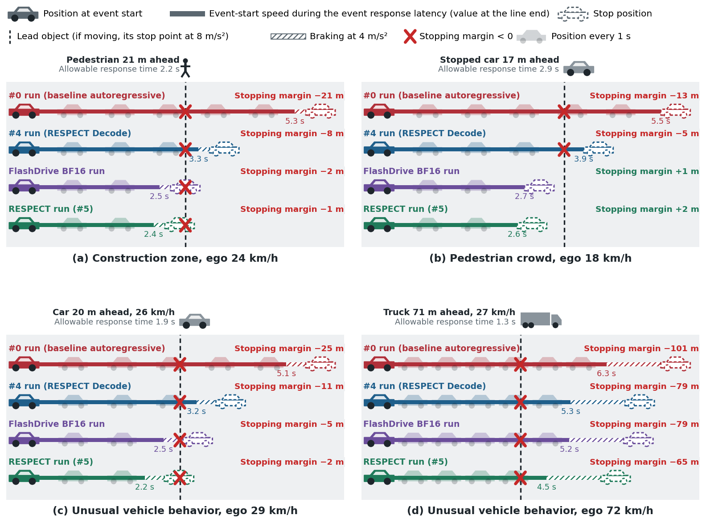
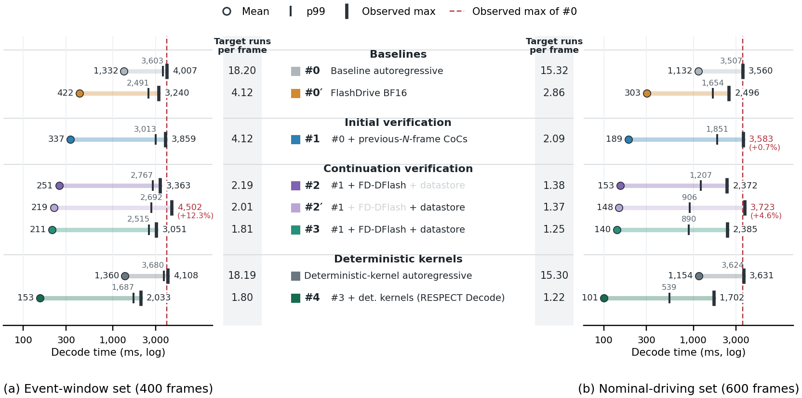
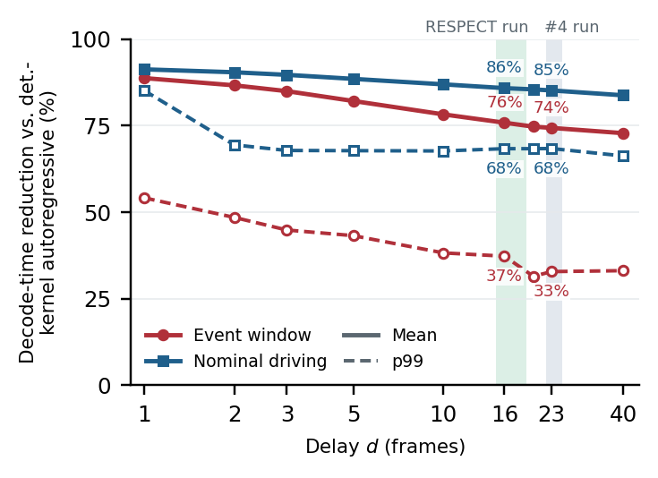
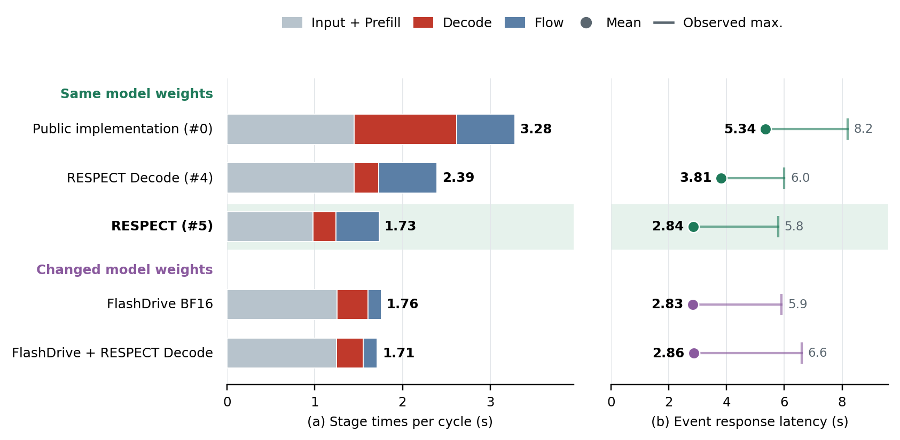
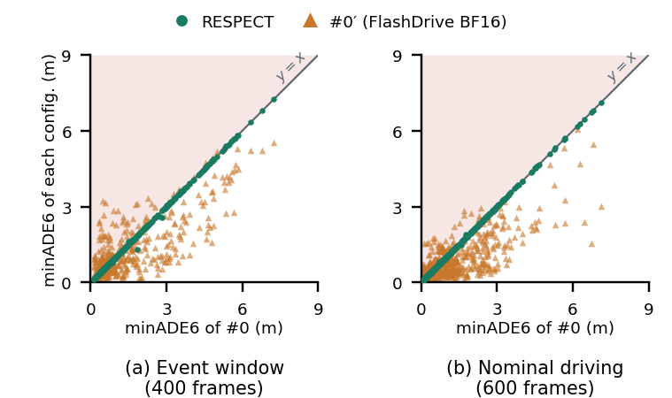

# RESPECT

**Output-preserving speculative decoding for autonomous driving.**

RESPECT brings forward the trajectories produced by a reasoning driving model.
It combines **RESPECT Decode**, which verifies previously completed reasoning
(CoC) in the current frame, with output-preserving **Prefill and Flow acceleration**.

[Main results](#main-results) · [Method details](docs/method_details.md) ·
[Evaluation protocol](docs/evaluation_protocol.md) · [Additional experiments and tables](docs/supplement.md) ·
[Reproduce without a GPU](#reproduce-the-results-without-a-gpu) ·
[Full reproduction guide](REPRODUCE.md) · [Raw results](results/paper/README.md) · [References](docs/references.md)

## Main results

Measured on **Jetson AGX Thor with Alpamayo 1.5, BF16, greedy decoding**:

- **Earlier response:** RESPECT reduces mean event response latency from
  **5.34 s to 2.84 s (47%)** in real-time replay of 10 event clips × 5 start positions.
- **More stopping margin:** in the four events where the public implementation
  exceeds the RSS allowable response time, RESPECT increases the **computed
  stopping margin by 15–36 m**.
- **Faster reasoning with reference outputs preserved:** RESPECT Decode reduces
  mean Decode time by **88.7% / 91.3%** on 400 event-window / 600 nominal-driving
  frames versus `deterministic-kernel autoregressive decoding`. CoC tokens and KV
  states match that reference on all 1,000 frames.

**Output-preservation reference:** Decode is compared with autoregressive decoding
using the same deterministic kernels (`deterministic-kernel autoregressive decoding`).
Accelerated Prefill and Flow are compared with the public stages on identical inputs.
This is not a claim of bitwise identity to the entire unmodified public pipeline.



*Real-time replay with constant ego speed until the new trajectory is available,
then braking at 4 m/s². These are computed stopping margins, not observed
closed-loop stopping outcomes; the truck event still has a negative margin.*

## Find the supporting evidence

| What to check | Where to go |
|---|---|
| Initial verification, correction token, and joint continuation trie | [Method details](docs/method_details.md) |
| Scored frames, preceding history, and data selection | [Data scope](data/README.md#selection-and-frame-scope) |
| Decode timing boundaries, warmup, and comparison conditions | [Evaluation protocol](docs/evaluation_protocol.md) |
| RSS assumptions and computed stopping-margin interpretation | [RSS protocol](docs/evaluation_protocol.md#7-rss-based-evaluation) |
| Real-time stage times and event response | [Figure 11](figures/fig11_realtime_breakdown.png) |
| Same-frame trajectories of three systems | [Figure 13 and its data](docs/supplement.md#7-trajectories-of-the-three-systems-on-the-same-frame) |
| Why $N = 4$; tree size, top-$k$, and node-budget selection (Sec. IV-B, IV-C) | [Setting selection](docs/supplement.md#2-setting-selection-on-the-development-set) |
| Candidate-source and kernel ablations (Sec. V-B) | [Ablations](docs/supplement.md#3-ablations) |
| Exact output-preservation comparisons | [Output preservation](docs/supplement.md#4-output-preservation) |
| Energy and memory tables (Sec. V-G) | [Energy and memory](docs/supplement.md#5-energy-and-memory) |
| Paper figures, supplementary tables, and equations index | [Paper figures, tables, and equations](docs/manuscript_map.md) |
| A paper result → its script, raw file, and expected value | [Paper item → source](REPRODUCE.md#paper-item--source) |
| Raw result files and field descriptions | [Result inventory](results/paper/README.md) |
| Hardware, software, and version-specific behavior | [Tested environment](docs/environment.md) |

## Reproduce the results without a GPU

From a checkout of this repository, install the CPU plotting dependencies and
recompute the summaries and measurement figures from the published raw results:

```bash
python -m pip install numpy matplotlib
python scripts/summarize.py results/paper
python scripts/summarize_additions.py results/paper
python scripts/make_figures.py results/paper --out figures
```

This recomputes the saved measurements; it does not rerun model inference.
For model access, input preparation, GPU measurements, and expected outputs, see
[REPRODUCE.md](REPRODUCE.md) and the [tested environment](docs/environment.md).

## How it works

**RE**use-based **SPEC**ulative decoding with **T**emporal drafts for reasoning
vision-language-action models.

A reasoning driving model such as [Alpamayo 1.5](https://github.com/NVlabs/alpamayo1.5)
writes a Chain of Causation (CoC) before it predicts a trajectory, so CoC
decoding delays every trajectory. Consecutive frames, 0.1 s apart, share most of
their input and usually repeat the same sentence. RESPECT Decode, the Decode
component of RESPECT, uses this in three steps:

1. verifies the $N$ most recently completed CoCs available when processing starts,
   merged into one trie, as speculative-decoding candidates in the current frame's
   context (initial verification);
2. where that stops, supplies FD-DFlash predictions and datastore continuations
   in one trie per target run (continuation verification);
3. verifies every trie with deterministic kernels whose reduction order does not
   depend on how many candidates are verified or where they sit in the KV cache,
   so the output tokens and KV states of committed tokens are **bitwise identical**
   to autoregressive decoding with the same deterministic kernels.

RESPECT combines RESPECT Decode with Prefill and Flow accelerated with outputs
bit-exact with the public implementation, so the whole processing cycle is faster
while the output guaranteed by RESPECT Decode is preserved.

## Detailed results

RESPECT is the full system; **RESPECT Decode** (`#4`) is its Decode component, and
**RESPECT** (`#5`) adds the bit-exact acceleration of Prefill and Flow (`respect/system/`).
Configuration codes follow Section V-A of the paper ([docs/supplement.md](docs/supplement.md) §1).
See [Paper figures, tables, and equations](docs/manuscript_map.md) for the figure and table index, and
[REPRODUCE.md](REPRODUCE.md) for the mapping of every reported result to its raw source.

**Decode time (Section V-B).** Jetson AGX Thor, Alpamayo 1.5 BF16, greedy decoding, Decode stage
only. All hyperparameters were chosen on a separate development set. Each scored
frame is timed twice, with configurations run in forward and reverse order;
the reported value is their mean.

| | Event window (400 frames) | | | Nominal driving (600 frames) | | |
|---|---:|---:|---:|---:|---:|---:|
| | mean | p99 | max | mean | p99 | max |
| `#0` baseline autoregressive (PyTorch kernels) | 1,332 ms | 3,603 ms | 4,007 ms | 1,132 ms | 3,507 ms | 3,560 ms |
| `deterministic-kernel autoregressive` (`K`, reference) | 1,360 ms | 3,680 ms | 4,108 ms | 1,154 ms | 3,624 ms | 3,631 ms |
| `#0′` FlashDrive BF16 | 422 ms | 2,491 ms | 3,240 ms | 303 ms | 1,654 ms | 2,496 ms |
| **`#4` RESPECT Decode** | **153 ms** | **1,687 ms** | **2,033 ms** | **101 ms** | **539 ms** | **1,702 ms** |

RESPECT Decode's CoC matched `deterministic-kernel autoregressive decoding` in 1,000 of 1,000
frames, with bitwise-identical committed KV states and therefore identical trajectories.



**Execution delay (Section V-D).** Inputs arrive every 0.1 s, but on this platform one frame of
the public implementation takes about 3.2 s (Prefill including Vision Encoding
1.40 s, Flow 0.50 s per trajectory). A frame can therefore only use CoCs that were
completed before its processing starts, $d > 1$ frames earlier. With the previous
CoCs limited to frames $t - d, t - 2d, \dots$, RESPECT Decode's output is still identical to
the reference. The real-time runs below observed median delays of $d = 23$ (`#4` run)
and $d = 16$ (`RESPECT` run):

| $d$ | 1 | 2 | 5 | 10 | 16 | 23 | 40 |
|---|---:|---:|---:|---:|---:|---:|---:|
| event window: `#4` mean (reduction vs. reference) | 153 ms (−88.7 %) | 182 ms (−86.6 %) | 243 ms (−82.1 %) | 296 ms (−78.2 %) | 329 ms (−75.8 %) | 349 ms (−74.3 %) | 370 ms (−72.8 %) |
| nominal driving: `#4` mean | 101 ms (−91.3 %) | 111 ms (−90.4 %) | 133 ms (−88.5 %) | 151 ms (−86.9 %) | 164 ms (−85.8 %) | 171 ms (−85.2 %) | 188 ms (−83.7 %) |

($d = 16, 23$ and $d = 40$ were measured in separate sessions; the nominal-driving set at
$d = 16, 23$ uses earlier frames added so that frames $t - d, t - 2d, \dots$ exist, and $d = 40$
covers the 578 frames with a previous frame at $t - 40$.)



**Real-time execution (Section V-E).** `scripts/run_realtime.py` feeds the event clips to the
board every 0.1 s on the wall clock and always processes the latest arrived frame
(earlier arrivals are dropped, so no queue builds up). Replacing only the Decode
stage with RESPECT Decode, over 10 clips × 5 start positions:

| | `#0` run (baseline autoregressive) | `#4` run (RESPECT Decode) |
|---|---:|---:|
| cycle time, mean | 3.28 s | **2.39 s** |
| Decode, mean | 1,169 ms | **283 ms** |
| trajectory age, mean | 5.03 s | **3.67 s** |
| time past the 6.4 s trajectory horizon | 9.70 % | **0.86 %** |
| event response latency (event start → first trajectory from a later input), mean | 5.34 s | **3.81 s** |

All 403 processed frames matched `deterministic-kernel autoregressive decoding`. Against the RSS minimum safe
distance (Section V-F), both runs still exceed the allowable response time in the four events
with a lead object in the ego lane; RESPECT Decode raises the stopping margin from
−13 to −25 m to −5 to −11 m in three of them and from −101 m to −79 m in the fourth
(72 km/h).

**Prefill and Flow (Section IV-E, Section V-E).** Prefill and Flow take 85.7% of a `#4` cycle. FlashDrive
shortens both, but its Prefill reuse of the previous window's KV holds only for
consecutive frames, so with the latest-frame policy it prefills all 16 images
through its compiled path, and its checkpoint uses Flow weights different from the
public ones. RESPECT shortens both stages with outputs bit-exact with the public
implementation (`respect/system/`): element-wise kernels that round where PyTorch
rounds, one vision-attention call for all images, and a fixed KV buffer with one
CUDA graph per diffusion step for Flow. Measured in real time in one environment
(PyTorch 2.11 wheel setup), 10 clips × 5 start positions:

| | cycle | Prefill | Decode | Flow | event response latency (mean / max) | model output |
|---|---:|---:|---:|---:|---:|:---:|
| `#4` run (RESPECT Decode) | 2.38 s | 1,391 ms | 282 ms | 662 ms | 3.80 / 6.02 s | kept |
| FlashDrive BF16 | 1.76 s | 1,203 ms | 352 ms | 154 ms | 2.83 / 5.90 s | changed (own Flow weights; median 1.48 m apart at equal CoC) |
| FlashDrive + `#4` Decode | 1.71 s | 1,199 ms | 306 ms | 157 ms | 2.86 / 6.60 s | changed (own Flow weights) |
| **`#5` RESPECT** | **1.73 s** | **932 ms** | **260 ms** | 493 ms | **2.84 / 5.78 s** | **kept** |

RESPECT shortens the cycle time of the `#4` run by 27% and its event response
latency by 0.96 s (95% confidence interval 0.81–1.12 s, clips resampled). Its Decode time is
26% shorter than FlashDrive BF16's (the reduction is 64.7 / 66.5% at $d = 1$), and
its event response latency is at the same level in mean (−0.01 s, −0.20–0.21 s) and
maximum. All 295 processed frames matched, bit for bit, a recomputation with the public
Prefill, `deterministic-kernel autoregressive decoding`, and public Flow; on the 1,000
evaluation frames the accelerated Prefill and Flow give the same KV cache, hidden
states, and trajectory bits as the public implementation.



*Figure 11. Ten event clips × five start positions. Input + Prefill includes
preprocessing, tokenization, and Vision Encoding. The groups distinguish model
weights; the output-preservation references are defined above. The `#0` and `#4`
rows use PyTorch 2.8; the other rows use PyTorch 2.11 (see the reproduction guide).*

**Same-frame trajectories (Section V-G).** On the pedestrian-crowd frame used in Fig. 13,
RESPECT differs from the public implementation by at most **0.0204 m per
coordinate**, while the mean endpoints of FlashDrive BF16 and the public
implementation are **15.18 m** apart. Each system contributes six trajectories
with the same Flow noise samples. The plotted RESPECT trajectories were measured
with `#4`, as in the paper.


*Figure 13, BEV comparison. The camera panel is omitted from this public rendering;
sensor images require access to the dataset. The plotted coordinates and the
[figure generator](scripts/paper_system_figures.py) are public. This single-frame
comparison illustrates output differences, not comparative safety or accuracy.*

**Trajectory error (Section V-G).** Six trajectories per frame from six different noise samples,
the same six on every frame. RESPECT (measured with `#4`, which gives the same CoC)
produces the trajectories of `deterministic-kernel autoregressive decoding`: on the 975 frames
where that run gives the CoC of `#0`, its minADE6 differs from `#0` by a median of
0.0022 m (event-window) and 0.0023 m (nominal-driving), and on the other 25 frames the mean minADE6 difference is below 0.05 m (per-frame maximum difference 0.55 m and 0.13 m). FlashDrive BF16 has a 0.29 m (95% confidence interval 0.03–0.56 m) and
0.38 m (0.22–0.54 m) smaller mean minADE6, but with its own Flow weights and CoCs
its minADE6 differs from `#0` by a median of 0.43 / 0.33 m and at most 3.21 / 5.19 m.
RESPECT's points therefore lie near the diagonal of Fig. 14, and its mean minADE6
differs from `#0` by less than 0.003 m on both sets.



## Installation

See [docs/environment.md](docs/environment.md) for the tested environment
(Jetson AGX Thor, JetPack 7.2, CUDA 13.0, Python 3.12). Two PyTorch setups are
supported:

- **Reproducing the paper**: PyTorch 2.8.0 built from source with
  [`environment/pytorch-v2.8.0-thor.patch`](environment/pytorch-v2.8.0-thor.patch).
- **Using RESPECT**: the standard wheel `torch==2.11.0+cu130` with Triton 3.7.1.
  RESPECT's output stays bitwise identical to `deterministic-kernel autoregressive decoding`
  with the same kernels, but tokens, times, and trajectories differ slightly from the paper's.

For a new environment, follow the complete
[PyTorch 2.11 installation commands](docs/environment.md#pytorch-211-wheel),
including the pinned dependencies and documented upstream metadata differences.
For an existing compatible Alpamayo 1.5 environment (commit `2eff703`), install
this package without dependency resolution so that pip does not replace PyTorch:

```bash
pip install --no-deps -e .
```

Model weights and the dataset are gated on Hugging Face:
`nvidia/Alpamayo-1.5-10B`, `z-lab/Alpamayo-1.5-10B-DFlash`,
`nvidia/PhysicalAI-Autonomous-Vehicles`.

## Minimal Decode example

After installation and Hugging Face login, run these commands from the repository root:

```bash
# CPU: prepare two frames from one event clip using the pinned dataset revision.
# Requires access to nvidia/PhysicalAI-Autonomous-Vehicles; sensor files may be downloaded.
python examples/decode.py --inputs runs/example_inputs --prepare-inputs-only

# GPU: RESPECT Decode (#4), followed by token and committed-KV checks against K.
python examples/decode.py --inputs runs/example_inputs --out runs/decode_example.json
```

If you already built the evaluation inputs, point `--inputs` to that directory and
skip preparation. Add `--local-files-only` to load the target from its local cache;
the DFlash snapshot must already have been downloaded during installation.
Use `--clip-prefix` and `--frames` consistently in both commands to select other frames.
Load only `.pt` files that you built or trust.

The [complete example](examples/decode.py) defines the inputs, builds the static
datastore from development CoCs, and starts with empty per-drive history. It creates
fresh Prefill KV for each frame, verifies previous CoC candidates, and adds each
completed output to the history for the next frame. The current frame's output never
enters its own candidates. The first frame has no previous CoC; the second can reuse
the first generated output. Thus, this small stream has different history from the
paper's offline evaluation and does not reproduce its latency statistics.
The equality checks use the same loaded input for `#4` and `K`; they do not assert
byte-identical sensor inputs or archived paper tokens after rebuilding the data.

The two-frame example was checked on Jetson AGX Thor with PyTorch 2.11.0+cu130
and Triton 3.7.1; tokens and committed KV matched `K` on both frames. The initial check used an existing environment; a subsequent check installed a new
isolated environment and rebuilt both inputs. Model/data download caches and the
existing JetPack/CUDA installation were reused. See the installation guide for
the recorded dependency-check exceptions.

Successful execution prints `tokens_equal=True, kv_equal=True, eos=True` for each
frame and saves the checks, tokens, input hashes, and environment versions to JSON.
The reference `K` is `deterministic-kernel autoregressive decoding` under the same deterministic kernels and
current-frame Prefill. This example runs **RESPECT Decode (`#4`)**; it does not run
Flow or the complete **RESPECT (`#5`)** Prefill/Flow acceleration. For full-system
replay and paper measurements, use [REPRODUCE.md](REPRODUCE.md).

## Reproducing the paper

[Method details](docs/method_details.md) explain verification and output preservation; the [evaluation protocol](docs/evaluation_protocol.md) defines the data, timing, and safety-evaluation conditions; and [references](docs/references.md) list the background sources.

[docs/supplement.md](docs/supplement.md) provides the setting selection, ablations, and
detailed comparison tables.
[REPRODUCE.md](REPRODUCE.md) links paper results to scripts, output fields, and
expected values. The paper's raw results are in
[`results/paper`](results/paper); `scripts/summarize.py`,
`scripts/summarize_additions.py`, and `scripts/make_figures.py` recompute the public
summary statistics and figures without a GPU (Fig. 13: BEV only).

## Layout

```
respect/            library
  candidates/       previous-CoC trie, datastore, FD-DFlash tree
  decoding/         fixed-capacity KV buffer, trie verification, RespectDecoder, sequential reference
  kernels/          Triton matmul, RMSNorm and attention with a fixed summation order
  alpamayo/         Alpamayo 1.5 loading, Prefill, Flow trajectories, power sampling
  eval/             evaluation frames, per-frame candidate sources, real-time metrics
  system/           bit-exact Prefill and Flow acceleration of RESPECT (fused element-wise kernels, Flow CUDA graphs)
scripts/            development set, hyperparameter selection, evaluation, aggregation and figure scripts
baselines/          FlashDrive BF16 baseline and its stages linked with RESPECT Decode
data/               evaluated and development clips, frames and reference CoCs
results/paper/      raw results of the paper
figures/            figures drawn from results/paper
docs/               method details, evaluation protocol, references, environment and supplementary results
environment/        PyTorch patch and exact package list of the tested environment
tests/              unit tests and bitwise kernel checks
```

## License

Apache-2.0. See [THIRD_PARTY_NOTICES.md](THIRD_PARTY_NOTICES.md) for the vendored
FD-DFlash network (MIT) and the licenses of models and data.
