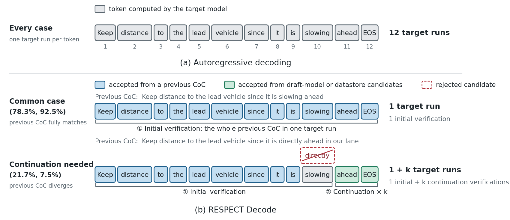
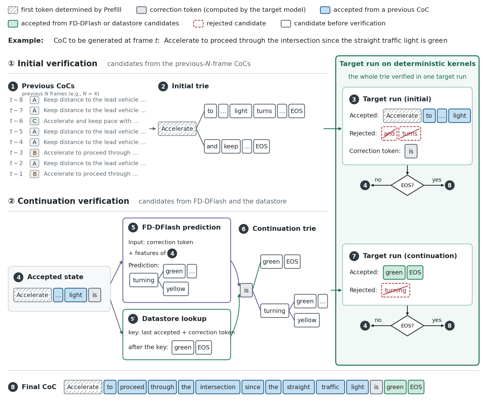
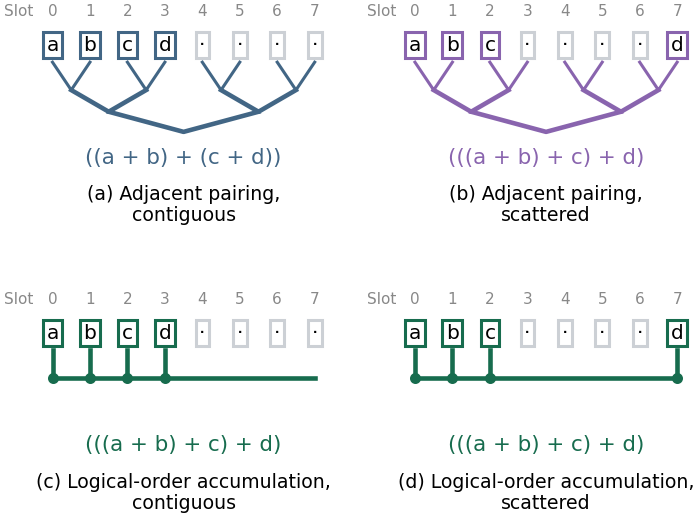

# Method details

RESPECT combines **RESPECT Decode** (`#4`), which verifies completed reasoning from previous frames in the current frame's context, with bit-exact **Prefill and Flow acceleration** (`#5`).

This document provides the detailed algorithmic descriptions corresponding to Sections III and IV of the paper, along with future directions discussed in Section VI.

The [supplementary results](supplement.md) contain the development-set parameter sweeps and comparison tables, and the [reproduction guide](../REPRODUCE.md) links each reported result to its raw measurement file.

| Topic | Explanation |
|---|---|
| Current-frame context and acceptance | [1. Context and output reference](#1-context-and-output-reference) |
| Previous-CoC candidates and termination | [2. Initial verification](#2-initial-verification) |
| Accepted token not yet forwarded | [3. Correction token](#3-correction-token) |
| Predicted and retrieved continuations | [4. Continuation candidate sources](#4-continuation-candidate-sources) |
| Shared trie and total budget | [5. Joint verification](#5-joint-verification) |
| Candidate cost versus saved target runs | [6. Decode cost](#6-decode-cost) |
| Logical token order and KV preservation | [7. Deterministic verification](#7-deterministic-verification) |
| Pairwise versus logical-order kernel comparison | [8. Kernel reduction-order comparison](#8-kernel-reduction-order-comparison) |
| Full-system preservation | [9. Prefill and Flow acceleration](#9-prefill-and-flow-acceleration) |
| Future directions, separate from the implemented system | [10. Future work](#10-future-work) |

*Fig. 2. The same CoC is shown with tokens simplified to words. Percentages refer to event-window and nominal-driving evaluation frames; the illustration contrasts one target run per token with initial verification followed by continuation when needed.*

## 1. Context and output reference

[Alpamayo 1.5](references.md#models-and-data) runs Vision Encoding, Prefill, Decode, and Flow in that order (Section I, Section III).

Prefill builds the current frame's KV cache from the visual tokens, prompt, and ego history; Decode generates the Chain of Causation (CoC), and Flow generates trajectories conditioned on the completed CoC and internal state.

RESPECT Decode reuses previous CoC token sequences as candidates and verifies them against the Prefill KV newly computed from the current input (Section III-B, Section IV-A).

The target model runs in BF16 with greedy decoding at temperature 0.

Following speculative decoding ([Leviathan et al.](references.md#speculative-decoding-and-retrieval)), at each position the same allowed-token constraint as in autoregressive decoding is applied before taking the argmax, and verification accepts the longest matching prefix (Section III-B).

RESPECT Decode's reference is autoregressive decoding with the same deterministic kernels (`deterministic-kernel autoregressive decoding`) and the same Prefill state: the complete CoC, termination position, and KV states of committed tokens must match that reference.

For Prefill and Flow acceleration, the reference is the corresponding public-implementation stage on identical inputs (Section IV-E).

## 2. Initial verification

Initial verification takes the CoCs of the $N$ most recently completed frames and removes duplicate token sequences before merging their shared prefixes into a prefix tree (trie) (Section IV-A, Section IV-B).

When every frame is processed in order, these are the $N$ consecutive frames before the current frame; the selected setting is $N = 4$.

The first CoC token is already determined by the Prefill logits, so candidates with a different first token are removed before constructing the trie.

If no candidate qualifies, the trie contains the single first-token node.

Each qualifying CoC is kept whole, including EOS, so one target run can accept a complete sentence.

A tree-attention mask permits each node to attend to its own ancestor path without mixing sibling branches (Section II, Section IV-B).

One target run verifies the initial trie; if EOS is accepted, CoC generation ends without supplying continuation candidates.

The maximum generated length is 128 tokens, as in the model configuration and the FlashDrive implementation.

Both autoregressive references and RESPECT Decode ended with EOS before this limit on all 400 event-window and 600 nominal-driving frames; their longest CoCs, including EOS, had 55 and 48 tokens, respectively.

The 64-node continuation budget does not truncate the initial trie.

At $N = 4$, initial tries exceeded 64 nodes on 3.3% of frames in each development set, but initial verification still processed the complete trie in one target run.

The development-set selection of $N$ and the query-tile boundary are documented in [setting selection](supplement.md#2-setting-selection-on-the-development-set).

## 3. Correction token

When a candidate first differs from the target prediction, or ends before the current CoC is complete, the target's token at that next position is accepted as the correction token (Section III-B, Section IV-A).

For example, if a candidate is $(u, v, w)$ and the target predicts $(u, v, z)$ from the same prefix, verification accepts $(u, v)$ followed by the correction token $z$.

The correction token is a pending accepted token: its identity has been determined, but it has not yet been supplied to a target-model forward pass.

The accepted path's KV and the next logical token position are retained, and the correction token becomes the root of continuation verification.

## 4. Continuation candidate sources

**[FD-DFlash](references.md#models-and-data)** is the draft model released by FlashDrive (`z-lab/Alpamayo-1.5-10B-DFlash`) for Alpamayo 1.5; RESPECT Decode uses its weights without additional training (Section IV-A, Section IV-C).

Its input block has eight positions: the correction-token embedding followed by mask embeddings, with target features from designated target-model layers.

The first position is the correction token, and predictions at the other seven positions supply candidates.

Target features are initialized from Prefill and updated with the accepted path after each target run, so the first draft after initial verification uses the context accepted in that verification.

The top-$k$ tokens at each predicted position provide branches beyond the top-1 chain, ordered by cumulative probability; the selected draft-tree size is 16 and top-$k$ is 4.

**The datastore** retrieves sequences extending the accepted output using a suffix-based scheme following [REST](references.md#speculative-decoding-and-retrieval) (Section IV-C).

It first uses the last two committed tokens, including the correction token, as a lookup key, and falls back to a one-token key if no match exists.

A static index contains development-set CoCs, while a drive index contains CoCs completed earlier in the same drive.

Both indices directly map one- and two-token keys to counts of following token sequences.

A lookup sums occurrence counts across the two indices and returns continuations in decreasing frequency, from the end of the matched key through the stored sentence's end.

FD-DFlash can supply predictions where no stored continuation matches; the datastore supplies continuations observed in stored CoCs.

## 5. Joint verification

Both candidate sources provide sequences rooted at the correction token, and shared prefixes occupy shared nodes in one continuation trie (Section IV-C).

FD-DFlash sequences are inserted first, followed by datastore sequences in decreasing occurrence frequency.

The 64-node budget applies to the entire continuation trie, including the root and shared prefixes.

If inserting a complete candidate sequence would exceed that budget, it is skipped and the next candidate is considered.

After verification, the accepted path's KV is gathered in logical token order, and the next correction token becomes the root of the next verification.

Candidate supply and verification repeat until EOS is accepted or the maximum generated length is reached.

The joint draft-tree size and top-$k$ selection is detailed in [setting selection](supplement.md#2-setting-selection-on-the-development-set).

**Repository implementation note.** In [`RespectConfig`](../respect/config.py), `draft_tree_nodes = 16` counts predicted draft nodes excluding the correction-token root, as specified by [`FDDFlash.tree`](../respect/candidates/fd_dflash.py).

The total continuation-trie budget (`64`) includes that root; these two node-count conventions should be distinguished when reading the draft-node configuration.

*Fig. 5. Sentences A and B and the current CoC are recorded consecutive-frame examples; sentence C and the FD-DFlash prediction tree illustrate branching. All target runs use the deterministic verification path, and tokens are simplified to words.*

## 6. Decode cost

The Decode time $T_t$ of frame $t$ separates initial verification from each continuation round's candidate-building and verification costs (Section IV-A, Section IV-C):

$$
T_t = T_t^{\mathrm{initial}} + \sum_{r=1}^{R_t}\bigl(G_r + V(M_r)\bigr).
$$

Here, $T_t$ is the Decode time of frame $t$, $T_t^{\mathrm{initial}}$ is its initial verification time, $R_t$ is the number of continuation target runs, $G_r$ is the candidate-building cost of round $r$, and $V(M_r)$ is verification and state handling for $M_r$ trie nodes.

Candidate acceptance must save enough target runs to offset candidate-building and verification costs.

The design therefore balances those costs against the number of saved target runs rather than maximizing the candidate count.

## 7. Deterministic verification

A tree-attention mask specifies which KV values a node can read, but does not determine the order or scheme used to reduce those values (Section I, Section II, Section IV-D).

Default PyTorch kernels can change tiling and partial-sum grouping with the input shape, so mathematically equivalent batched and per-token computations can differ in finite precision; see the [PyTorch and NVIDIA numerical documentation](references.md#numerical-execution-and-memory).

In FP32 with $a = 1$ and $b = c = 2^{-24}$, $(a + b) + c$ yields $1$, whereas $a + (b + c)$ yields $1 + 2^{-23}$ (Section IV-D).

If two token logits differ by less than a rounding difference, the argmax can flip even under the same acceptance rule.

RESPECT Decode uses deterministic [Triton](references.md#numerical-execution-and-memory) kernels for matrix multiplication, RMS normalization, attention, and vocabulary projection ([He and Thinking Machines Lab; Zhang et al.](references.md#numerical-execution-and-memory), Section IV-D).

Matrix multiplication and normalization keep the reduction order and precision fixed across input row counts; the linear layers use 32-row tiles.

Trie attention additionally separates logical token order from physical KV slots: a node's ancestors can occupy scattered slots among sibling branches.

*Fig. 6. The four panels show the reduction schemes for the same values in contiguous and scattered slots; physical slot order and logical token order are different concepts.*

Nodes are arranged with parents before children, and each node accumulates its ancestor-path values one at a time in logical token order (`logical-order accumulation`).

After each target run, only the committed path's KV is gathered into consecutive slots in logical token order, so the next run starts with the same committed state as `deterministic-kernel autoregressive decoding`.

Following [Kwon et al.](references.md#numerical-execution-and-memory) for KV-buffer management, RESPECT Decode preallocates a fixed-capacity KV buffer beyond Prefill storage (up to 1,024 slots, accommodating an initial trie of up to four CoCs and a CoC of up to 128 tokens).

**Repository implementation note.** [`FixedKVBuffer`](../respect/decoding/kv_buffer.py) allocates the backing buffer using the largest configured capacity and exposes smaller window views of that storage.

The default capacities are 192, 256, 512, and 1,024 slots beyond Prefill; [`RespectDecoder`](../respect/decoding/respect.py) selects a fitting window for initial verification and, for the default 128-token limit and 64-node continuation budget, uses a 192-slot continuation window.

This window size is distinct from the total backing allocation.

## 8. Kernel reduction-order comparison

Section IV-D reports placing the same 26 attention KV values in contiguous slots or in scattered slots (`0–17` and `200–207`), reproducible via `python scripts/run_kernel_order.py --inputs INPUTS`.

Adjacent-slot pairwise reduction changed the attention output by up to $2.44 \times 10^{-4}$, whereas logical-order accumulation produced identical outputs (`0` difference).

On the 400 event-window frames, the two schemes produced CoCs differing from `deterministic-kernel autoregressive decoding` on `3/400` and `0/400` frames, respectively (Section IV-D).

The public `results/paper` files contain the logical-order implementation's token and committed-KV equality checks (`0/400` and `0/600` mismatches); the earlier development pairwise-kernel run's individual per-frame token logs are not part of `results/paper` ([source map](../REPRODUCE.md#paper-item--source)).

This `3/400` kernel reduction-order comparison is separate from the three frames with “Turn left” versus “Turn right” wording in the comparison between `deterministic-kernel autoregressive decoding` and the default public implementation `#0` ([output preservation](supplement.md#4-output-preservation)); those two comparisons use different references.

## 9. Prefill and Flow acceleration

With RESPECT Decode (`#4`), Prefill (`1,388 ms`) and Flow (`664 ms`) account for `85.7%` of mean cycle time on Thor (Section IV-E, Section V-E).

RESPECT (`#5`) adds bit-exact Prefill and Flow acceleration to RESPECT Decode (`respect/system/`).

Fused elementwise Triton kernels preserve PyTorch's rounding points, one vision-attention call processes all images, and a Flow CUDA Graph executes the iterative diffusion steps against a fixed KV buffer.

On all 1,000 evaluation frames, the accelerated Prefill KV states and Flow trajectories matched their public-implementation counterparts bit for bit on identical inputs (`results/paper/flashdrive_unified/respect.jsonl`).

Because the accelerated Prefill supplies the identical KV state, it preserves the starting context used by RESPECT Decode.

Decode preservation continues to use `deterministic-kernel autoregressive decoding` as its reference, while Prefill and Flow preservation use the public-implementation stages on identical inputs.

## 10. Future work

Section VI outlines two future directions beyond the implemented RESPECT system:

1. **Earlier Flow execution:** running Flow conditioned on a previous CoC before current-frame Decode completes (or offloading CoC verification/generation), and replacing the trajectory only when verification changes the CoC, under a separately defined output-preservation and safety contract.
2. **Closed-loop simulation:** evaluating how latency reduction affects actual vehicle trajectories and stopping outcomes when generated trajectories control the vehicle and alter subsequent sensor inputs.

These are future research directions discussed in Section VI, separate from the implemented RESPECT pipeline and the measurements in `results/paper`.
