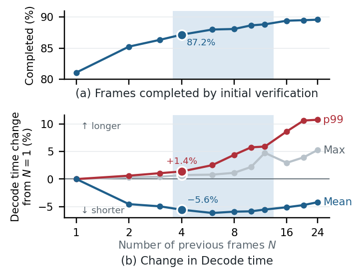
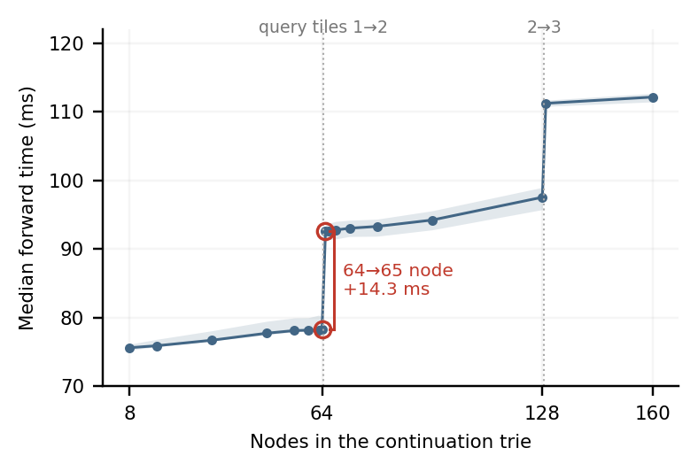
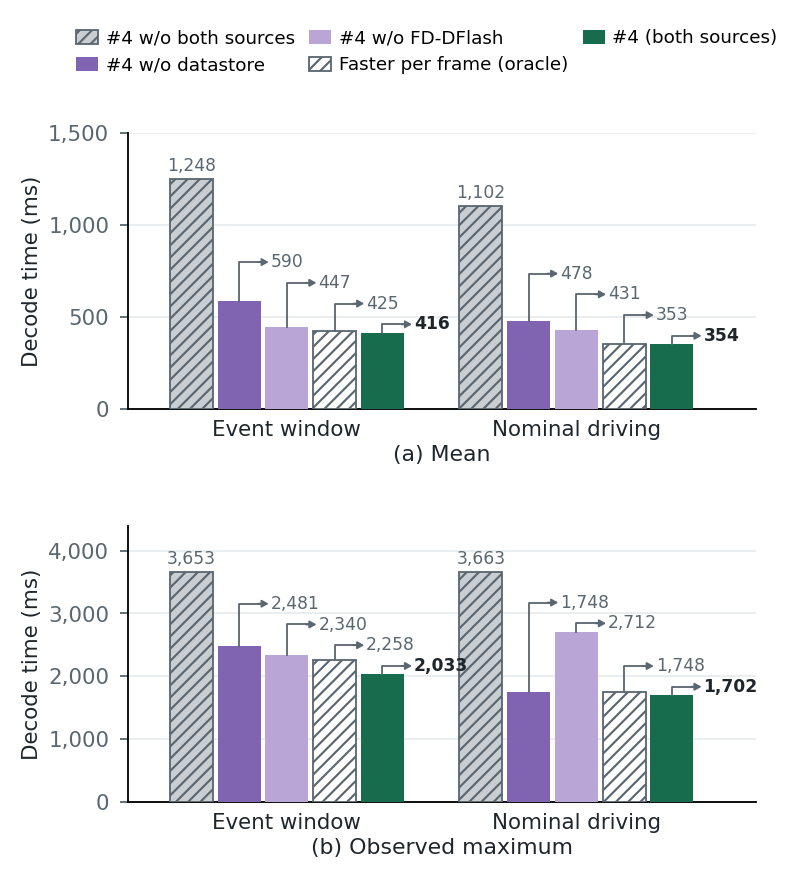
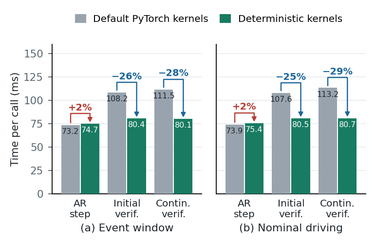
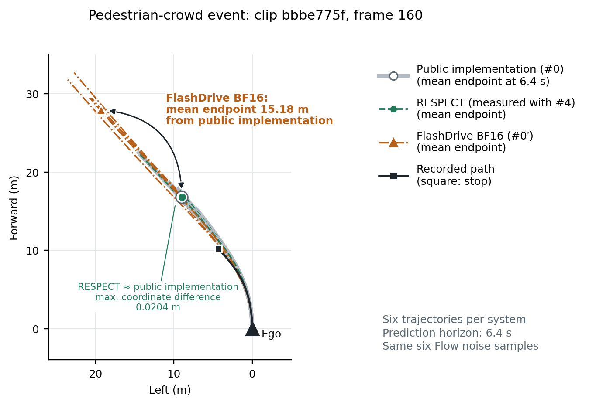

# Supplementary results

This page provides the full development-set parameter sweeps, ablations, and detailed comparison tables cited in Sections IV-B, IV-C, and V of the paper. The result tables and data-driven figures use the saved measurements in [`results/paper`](../results/paper) and are produced by `scripts/summarize.py`, `scripts/summarize_additions.py`, and `scripts/make_figures.py`; [REPRODUCE.md](../REPRODUCE.md) maps each item to its script and output field.

## 1. Configurations

| Config. | Definition | Prev. CoC | FD-DFlash | Datastore | Det. kernels | Bit-exact Prefill/Flow |
|---|---|:-:|:-:|:-:|:-:|:-:|
| `#0` | baseline autoregressive decoding (public implementation) | – | – | – | – | – |
| `#0′` | FlashDrive BF16 (temperature 0, W4A8 off) | – | ✓ | – | – | – |
| `#1` | `#0` + initial verification of the previous-$N$-frame CoCs | ✓ | – | – | – | – |
| `#2` | `#1` + FD-DFlash | ✓ | ✓ | – | – | – |
| `#2′` | `#1` + datastore | ✓ | – | ✓ | – | – |
| `#3` | `#1` + FD-DFlash + datastore | ✓ | ✓ | ✓ | – | – |
| `#4` | `#3` + deterministic kernels (**RESPECT Decode**) | ✓ | ✓ | ✓ | ✓ | – |
| `#5` | `#4` + bit-exact Prefill and Flow (**RESPECT**) | ✓ | ✓ | ✓ | ✓ | ✓ |
| `#4` w/o datastore | `#4` − datastore | ✓ | ✓ | – | ✓ | – |
| `#4` w/o FD-DFlash | `#4` − FD-DFlash | ✓ | – | ✓ | ✓ | – |
| `#4` w/o both sources | `#4` − FD-DFlash − datastore | ✓ | – | – | ✓ | – |

`Deterministic-kernel autoregressive decoding` (the output-preservation reference `K`) runs `#0` token by token on the deterministic kernels.

## 2. Setting selection on the development set

All settings were chosen on a development set disjoint from evaluation (15 event-window clips, 600 frames; 30 nominal-driving clips, 300 frames; Section IV-B, Section IV-C, Section V-A) with one rule: the criterion is the average of the mean Decode times of the two development sets, settings within 1% of the minimum are treated as equivalent (repeated measurements varied the criterion by 1.1%), and the smallest parameter value among them is chosen. The chosen values were applied to the evaluation set without re-tuning.

**Number of previous frames $N$ (Section IV-B).** The mean Decode time was shortest at $N = 6$ and within 1% of the minimum from $N = 4$ to $12$, so $N = 4$ is chosen; p99 and the observed maximum grow with $N$. Widening the candidates from the previous frame to the previous four raised the frames completed by initial verification from 81.1% to 87.2%.

**Continuation settings (Section IV-C)** (changed one at a time at $N = 4$, with the other settings kept at their chosen values; bold = chosen):

| Setting | Mean Decode (ms) | p99 (ms) | Accepted tokens per continuation run |
|---|---:|---:|---:|
| *Datastore scope* | | | |
| drive index | 126.8 | 1,305 | 3.51 |
| **drive + static index** | **124.7** | **1,355** | **3.75** |
| *Datastore key length* | | | |
| 1 token | 127.0 | 1,354 | 3.58 |
| **2 tokens** | **124.7** | **1,355** | **3.75** |
| 3 tokens | 124.6 | 1,368 | 3.75 |
| *FD-DFlash nodes* | | | |
| 7 | 127.8 | 1,487 | 3.50 |
| **16** | **124.7** | **1,355** | **3.75** |
| 32 | 124.9 | 1,419 | 3.77 |
| 48 | 130.0 | 1,528 | 3.42 |
| *Branch candidates per position (top-$k$)* | | | |
| 2 | 125.7 | 1,448 | 3.66 |
| **4** | **124.7** | **1,355** | **3.75** |
| 8 | 124.5 | 1,357 | 3.76 |
| *Continuation node budget* | | | |
| 32 | 130.9 | 1,502 | 3.27 |
| **64** | **124.7** | **1,355** | **3.75** |
| 128 | 127.9 | 1,468 | 3.86 |

**Joint selection of the FD-DFlash node count and top-$k$.** The lowest mean Decode time among the joint node-count and top-$k$ settings (`summary.json: dev.tables.tree_topk_budget`) was 123.9 ms, obtained with 32 FD-DFlash nodes and $k = 8$. The setting with 16 nodes and $k = 4$ was within 0.7% of this minimum and was selected because it used the fewest nodes among settings within 1% of the minimum and the smallest $k$ at that node count; the table above varies one setting at a time around these selected values.

**Node budget and the query tile (Section IV-C).** The attention kernel processes queries in 64-row tiles; adding a 65th node requires a second 64-row query tile and increases forward-pass time by 14.3 ms (median across the four measured development frames), so the continuation budget is set to 64.

## 3. Ablations

**Initial verification and the comparison scope (Section V-B).** Initial verification alone (`#1`) reduces mean Decode time by 74.7% and 83.3% relative to `#0` on the event-window and nominal-driving sets, respectively.

Its nominal-driving observed maximum (`3,583 ms`) nevertheless exceeds `#0`'s (`3,560 ms`): if few initial tokens are accepted, `#1` pays for initial verification and then generates the remaining span autoregressively.

Moving from `#1` to `#2` or `#2′` changes the continuation mechanism and cache path as well as the candidate source.

The candidate-source ablation therefore holds the deterministic kernels fixed and removes sources from `#4` on the same frames requiring continuation (Section V-B, Fig. 8).

**Candidate sources (Section V-B).** On the 87 event-window and 45 nominal-driving frames that need continuation, each single source at least halves the mean Decode time of `#4` w/o both sources, and both sources together (`#4`) cut it by 66.6% and 67.9%; continuation target runs fall from 15.29 / 13.36 to 3.69 / 2.98 per frame. `#4` approaches the mean of a per-frame oracle that retrospectively picks the faster single source for each frame and achieves a lower observed maximum.

Among the single-source configurations, the datastore-only configuration is faster on 74 event-window and 35 nominal-driving continuation frames; FD-DFlash alone is faster on the remaining frames.

Datastore alone has the shorter mean on both sets but the larger nominal-driving observed maximum (`2,712 ms` vs. `1,748 ms`), so the source with the shorter mean is not uniformly faster.

On the 900 development frames (`results/paper/dev_ablation/`), the same ablation also reduces mean Decode time in the order of neither source, FD-DFlash alone, datastore alone, and both sources.

**Deterministic kernels (Section V-B).** They shorten each initial or continuation verification call by 25.2–28.7% and lengthen each autoregressive step by 2.0–2.2%; `#3` and `#4` require almost the same number of continuation runs (3.64 vs. 3.69, 2.96 vs. 2.98, differing by at most 1.4%), so the 27% reduction in Decode time from `#3` to `#4` comes primarily from faster verification target runs.

Per-call time divides each operation's duration by its call count: initial verification runs once per frame, continuation verification once per loop iteration, and autoregressive generation once per token.

The autoregressive-step comparison uses `#0` and `deterministic-kernel autoregressive decoding`; the two verification comparisons use `#3` and `#4`.

### Event-window timing and delay

Section V-C (Fig. 9) groups frames into five-frame windows around the event start; `#4`'s mean Decode time is below 200 ms in every window.

This is a bound on window means, not on every individual frame's Decode time.

In the window 20–16 frames before the event (`−20 ~ −16`), `#4`'s observed maximum is about 30 ms larger than FlashDrive BF16's; that frame accepts only 8 of 51 tokens initially and requires 20 target runs in total.

[Figure 9](../figures/fig9_event_timeline.png) compares `#4` in PyTorch 2.8 with `#0′` in PyTorch 2.11; the separate same-environment all-frame comparison is described in the [evaluation protocol](evaluation_protocol.md#2-offline-comparison).

For delay $d = 40$ (Section V-D, Fig. 10), the nominal-driving comparison contains 578 frames with the required earlier history at $t - 40$, rather than the full 600.

On the 600 event-window development frames (`summary_additions.json: n_under_delay`), increasing $N$ from 4 to 8 raises the share having a whole-CoC-matching initial candidate by 1.5 percentage points at $d = 1$, 1.3 points at $d = 23$, and 3.5 points at $d = 16$ (21 frames).

These are candidate-availability measurements, not a timing-based re-selection of $N$ under delay; all reported delay experiments retain $N = 4$ selected at $d = 1$.

## 4. Output preservation

Frames whose complete CoC token sequence equals the specified reference (Section V-B):

| Compared | Reference | Event window | Nominal driving |
|---|---|---:|---:|
| `#0′` (FlashDrive BF16) | `#0` | 208/400 | 479/600 |
| `#3` (no deterministic kernels) | `#0` | 383/400 | 593/600 |
| `#4` (**RESPECT Decode**) | `deterministic-kernel autoregressive` | **400/400** | **600/600** |

The `#3` row corresponds to 17 event-window and 7 nominal-driving CoCs differing from `#0`, or 24/1,000 in total; `#0′` differs from `#0` on 192 + 121 = 313/1,000 frames.

The four source-ablation configurations all match `deterministic-kernel autoregressive decoding` on every frame.

That reference uses tile sizes and reduction orders different from the default PyTorch kernels, so its equality to `#4` does not imply token-for-token equality to `#0`.

`Deterministic-kernel autoregressive decoding` and `#0` agree on 380/400 and 595/600 frames (975/1,000), and `#4` agrees with `#0` at the same rate (Section V-G).

On 22 of the 25 differing frames only the rationale wording differs; on the other three, `deterministic-kernel autoregressive decoding` says “Turn left” and `#0` says “Turn right,” while the recorded path is a left turn with 9.2–10.3 m of leftward displacement over 6.4 s.

Those three frames belong to the comparison between the two autoregressive references; the separate [3/400 versus 0/400 kernel reduction-order experiment](method_details.md#8-kernel-reduction-order-comparison) compares pairwise versus logical-order reduction against `deterministic-kernel autoregressive decoding`.

## 5. Energy and memory

| Config. | Decode-region energy, event window (J) | nominal driving (J) | Peak CUDA memory (GiB) |
|---|---:|---:|---:|
| `#0` | 95.56 | 80.59 | 21.61 |
| `#0` + deterministic kernels (`K`) | 100.88 | 84.98 | 21.61 |
| `#0′` (FlashDrive BF16) | 31.75 | 23.07 | 22.73 |
| `#4` (**RESPECT Decode**) | **11.48** | **7.05** | 23.05 |
| `#5` (**RESPECT**) | **11.48** | **7.05** | 24.07 |

Energy is estimated per frame as the mean module power measured over the Decode region multiplied by the Decode time (Section V-G). The Decode-energy entries for `#5` use the values of `#4` because `#5` runs the exact same Decode computation as `#4` (it is not an independent full-cycle energy measurement).

Peak memory is the maximum CUDA memory allocated while sequentially processing Prefill, Decode, and Flow for the 1,000 evaluation frames (`results/paper/memory/`). Each configuration is measured in a separate process loading only its required modules, including their weights.

Relative to `#0` (`21.61 GiB`), RESPECT Decode (`#4`, `23.05 GiB`) increases peak memory by 1.44 GiB (6.7%) for the FD-DFlash weights (`0.88 GiB`) and fixed KV buffer (`0.57 GiB`). CUDA Graph replay reuses the memory addresses recorded at capture, so RESPECT (`#5`, `24.07 GiB`) retains a fixed buffer into which the KV read by Flow is copied and 57 graphs captured for different CoC lengths, adding 1.01 GiB relative to `#4` (11.4% total increase over `#0`).

## 6. Comparison with related acceleration methods

The table below summarizes how RESPECT Decode relates to prior speculative decoding and VLA acceleration methods discussed in Section II. The last two columns concern reuse of previous-frame outputs: how many previous frames' complete outputs are used as candidates for the current frame, and whether those reused outputs are verified by the target model in the current context (`n/a` indicates that previous-frame output reuse is not applicable).

Datastore retrieval means retrieving a stored continuation whose key matches the suffix of the accepted prefix.

| Method | Draft-model prediction | Datastore retrieval | Reused previous frames | Previous-frame output verified in current context |
|---|:-:|:-:|:-:|:-:|
| REST, LLMA, SuffixDecoding | – | ✓ | – | n/a |
| DFlash | ✓ | – | – | n/a |
| RASD | ✓ | ✓ | – | n/a |
| Spec-VLA, Reasoning-aware Speculative Decoding, FlashDrive | ✓ | – | – | n/a |
| Fast ECoT | – | – | 1 | – |
| **RESPECT Decode** | ✓ | ✓ | $N$ | ✓ |

## 7. Trajectories of the three systems on the same frame

`scripts/dump_trajectories.py` records the six trajectories of the public implementation (`#0`) on each evaluation frame with the same seeds as RESPECT (`run_main.py --flow`) and FlashDrive BF16 (`baselines/flashdrive/quality_fd.py --fixed-seed 0`), together with the ground-truth path and the front-camera image, for comparing the three systems on one frame (Section V-G, Fig. 13).

The frame of Fig. 13 (pedestrian-crowd event, clip `bbbe775f`, frame 160) is stored in [`results/paper/frame_trajectories/bbbe775f_0160.json`](../results/paper/frame_trajectories/bbbe775f_0160.json): the six trajectories of `#0`, RESPECT (`#4`), and FlashDrive BF16 (`#0′`) and the recorded path. `scripts/summarize_additions.py` computes from it the numbers of Fig. 13 (`fig13_frame`): RESPECT differs from `#0` by at most 0.0204 m in any coordinate (0.0244 m as a 2-D position, reported as approximately 0.02 m in the figure caption), and the mean endpoints of FlashDrive BF16 and `#0` are 15.18 m apart (reported as 15 m in the figure caption).

This public rendering includes the BEV comparison (`Fig. 13(b)`); the front-camera panel (`Fig. 13(a)`) requires access to the gated dataset and is not redistributed here. The RESPECT curves use the recorded `#4` trajectories. The recorded path is a separate reference; endpoint separation between models illustrates output differences and does not by itself establish which model is more accurate or safer.

Figures 11 and 13 are generated from public JSON files by [`scripts/paper_system_figures.py`](../scripts/paper_system_figures.py), which is also called by `scripts/make_figures.py`.

## 8. FlashDrive stage comparison and output differences

Section V-E reports 102 observations matched by clip, run start, and processed input frame where [FlashDrive BF16](references.md#models-and-data) and the public implementation produced the exact same CoC (`summary.json: section6.stage_link.trajectory_same_coc`).

Even on these same-CoC frames, the per-frame maximum trajectory-position difference from the public implementation had a median of 1.48 m and an observed maximum of 9.44 m because FlashDrive uses separately trained Flow weights and iteration reuse.

These are matched observations across the 50 real-time runs, not 102 independent clips or a ground-truth trajectory-error metric.

A separate check replacing FlashDrive's Flow weights with the public weights reduced the trajectory difference to below 1 cm; this is noted as an auxiliary diagnostic check (the individual log of that weight-swap check is not part of `results/paper/realtime_flashdrive`, and it is not a claim of bitwise preservation for FlashDrive's Flow).

### FlashDrive combined with RESPECT Decode

In the real-time comparison of Section V-E (Fig. 11), `FlashDrive + RESPECT Decode` (`D8` in `realtime_flashdrive/`) replaces only Decode between FlashDrive's Prefill and Flow, including KV-format conversion in Decode time.

Its median input-frame interval is $d = 16$ and initial verification alone completes 29.5% of cycles; overall Decode time is 13% shorter than FlashDrive BF16's (`306 ms` vs. `352 ms`), while mean event response latency is `2.86 s` versus `2.83 s` (difference `0.03 s`, 95% confidence interval `−0.11` to `0.16 s`).

On the 159 input frames processed by both runs with the same clip and start frame, Decode time falls from 219 to 127 ms on the 55 frames completed by initial verification, and changes from 372 to 362 ms on the 104 frames requiring continuation verification.

Continuation verification uses the same FD-DFlash draft model as FlashDrive, so the speedup depends on the share completed by initial verification; see [real-time result interpretation](evaluation_protocol.md#9-real-time-result-interpretation) for why shorter Decode time does not automatically reduce response latency when an earlier cycle is already in progress.
